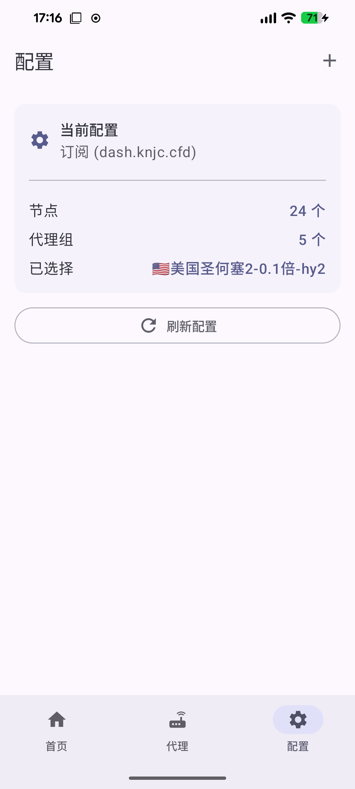

# RootFlow

[English](README.md) | 简体中文

RootFlow 是一款基于 Android root 的代理转发应用和 LSPosed 模块。它运行内置的 Mihomo 核心，并通过导入的 Clash 兼容配置，将受支持的 Google 系统应用流量转发到代理。



## 功能

- 导入 Clash 兼容 YAML 文件、HTTP(S) 订阅以及受支持的代理分享链接。
- 查看已导入的节点和代理组，并为 `Google Proxy` 代理组选择节点。
- 通过前台服务运行 Mihomo 核心，并使用 root 为受支持的 Google 应用配置流量转发。
- 可在开机后恢复运行；被其他 VPN 顶替后，会在该 VPN 断开时尝试恢复。Android 和设备厂商的后台启动限制可能要求在系统设置中允许应用自启动。
- 在应用中查看 LSPosed 框架连接状态和模块作用域状态。

应用需要 Android 13 或更高版本、可用的 root 管理器，以及已启用本模块并配置目标作用域的 LSPosed。RootFlow 不提供代理服务器或订阅服务。实际兼容性取决于导入的配置、Mihomo、Android 版本、root 实现、LSPosed 以及其他 VPN 或防火墙软件。

## 构建

使用包含兼容 Android Gradle Plugin 和 JDK 的 Android Studio 打开项目，或运行以下命令构建 Debug APK：

```sh
./gradlew assembleDebug
```

APK 输出目录为 `app/build/outputs/apk/debug/`。

## 免责声明

安装或使用 RootFlow 前，请阅读[免责声明](DISCLAIMER.md)。Root 权限会改变设备网络行为，可能影响网络连接或设备稳定性。

## 许可证

当前仓库未附带项目级许可证。在仓库添加许可证之前，请勿假设你已获得重新分发或修改 RootFlow 的授权。内置的 Mihomo 核心及其他依赖分别受其各自许可证约束。
